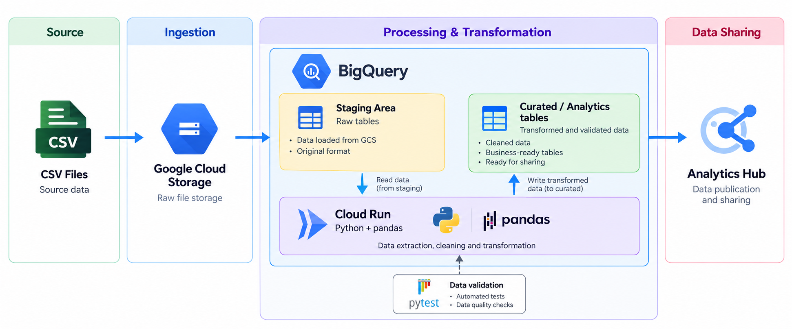

# 🚗 insurance-claims-gcp
End-to-end batch data engineering project using Python, Google Cloud Storage and BigQuery.
## 🚀Objective

Build an ETL pipeline to ingest, validate, transform and analyze synthetic automobile insurance claims data.

## Architecture


## Data Quality & Validation Rules

Data quality is a key component of the Insurance Claims Data Pipeline.

Before transformation, each record is validated using technical and business rules implemented in Python with **Pandas**. The process checks completeness, consistency, and validity before records are prepared for the BigQuery curated layer.

### 1. Validation Rules

| Category | Field | Validation Rule | Rejection Reason |
|---|---|---|---|
| Completeness | `claim_id` | Must not be NULL or empty | `MISSING_ID` |
| Uniqueness | `claim_id` | Must be unique within the batch | `DUPLICATE_ID` |
| Completeness | `policy_id` | Must not be NULL or empty | `INVALID_POLICY_ID` |
| Domain validation | `region` | Must belong to the predefined list of regions | `INVALID_REGION` |
| Domain validation | `claim_type` | Must belong to the predefined claim categories | `INVALID_CLAIM_TYPE` |
| Date validation | `claim_date` | Must be a valid date in YYYY-MM-DD format | `INVALID_CLAIM_DATE` |
| Date validation | `declaration_date` | Must be a valid date in YYYY-MM-DD format | `INVALID_DECLARATION_DATE` |
| Business consistency | `declaration_date` | Must be on or after `claim_date` | `DECLARATION_BEFORE_CLAIM` |
| Amount validation | `claim_amount` | Must be numeric and nonnegative | `INVALID_CLAIM_AMOUNT` |
| Amount validation | `reimbursement_amount` | Must be numeric and nonnegative | `INVALID_REIMBURSEMENT_AMOUNT` |
| Amount validation | `deductible_amount` | Must be numeric and nonnegative | `INVALID_DEDUCTIBLE_AMOUNT` |
| Business consistency | `reimbursement_amount` | Must not exceed `claim_amount` | `REIMBURSEMENT_EXCEEDS_CLAIM` |
| Schema validation | Required columns | All 11 expected columns must be present | `ValueError` (processing stops) |

### 2. Validation Workflow

1. **Schema verification:** Check that all required columns exist.
2. **Type conversion:** Parse dates and amounts with Pandas, marking invalid values.
3. **Business validation:** Check identifiers, categories, dates, and financial consistency.
4. **Record classification:** Split the batch into valid and rejected records, preserving rejection reasons.

### 3. Rejected Records Management

Invalid records are **not silently discarded**.

- **`valid_df`** contains records that pass all validation rules and can proceed to transformation.
- **`rejected_df`** contains records that fail one or more rules.

The `rejection_reasons` field stores error codes separated by `|`, for example:

```text
claim_id: CLM-000123
rejection_reasons: INVALID_REGION|INVALID_CLAIM_AMOUNT
```

When an identifier is duplicated, **all occurrences** are rejected using `duplicated(keep=False)` instead of arbitrarily retaining one.

### 5. Automated Testing

The validation and transformation logic is tested with **pytest**. Test cases cover negative amounts, missing regions, duplicate IDs, invalid date order, excessive reimbursements, valid records, missing required columns, multiple rejection reasons, and derived analytical fields.

Run tests from the project root:

```bash
python -m pytest tests/ -v
```