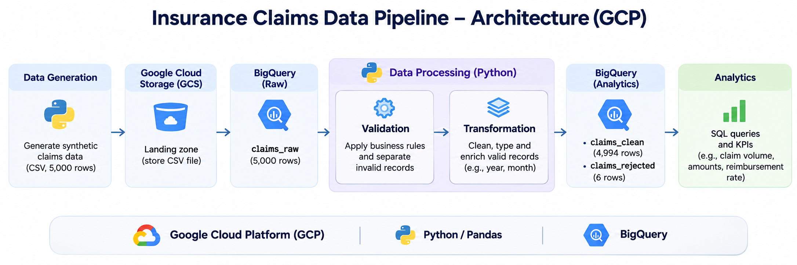

# 🚗 Insurance Claims Data Pipeline — GCP

**End-to-end batch data engineering project built with Python, Google Cloud Storage, and BigQuery.**

This project demonstrates how to build a reliable ETL pipeline for synthetic automobile insurance claims, from raw data ingestion to data quality validation and SQL analytics.

## 🎯 Project Objectives

The main objectives are to:

- Generate reproducible synthetic insurance claims data.
- Ingest raw CSV files into Google Cloud Storage and BigQuery.
- Apply business validation rules and isolate invalid records.
- Transform valid records into analytics-ready datasets.
- Implement automated testing and data integrity checks.
- Analyze insurance claims using SQL and business KPIs.

## 🏗️ Architecture

### Data Platform Architecture


### Pipeline Workflow

The pipeline follows a layered architecture:




| Step | Component | Description |
|---|---|---|
| 1 | Data Generation | Generate 5,000 synthetic insurance claims with deliberate data quality anomalies. |
| 2 | Google Cloud Storage | Upload the CSV file to a private GCS bucket under `landing/claims/`. |
| 3 | BigQuery Raw | Ingest source data into `raw_dt.claims_raw`, preserving the original fields as strings. |
| 4 | Data Validation | Apply business rules and separate valid and rejected records using Python and Pandas. |
| 5 | Data Transformation | Convert data types and enrich valid records with derived attributes. |
| 6 | BigQuery Analytics | Load validated records into `analytics_dt.claims_clean` and rejected records into `analytics_dt.claims_rejected`. |
| 7 | Data Quality Checks | Verify record counts, record conservation, and identifier uniqueness after loading. |
| 8 | SQL Analytics | Calculate insurance KPIs using curated BigQuery data. |

### Data Transformation

The transformation module enriches valid claims with the following fields:

| Field | Description |
|---|---|
| `claim_year` | Year of the claim |
| `claim_month` | Month of the claim |
| `declaration_delay_days` | Number of days between claim occurrence and declaration |
| `unreimbursed_amount` | Difference between the claim amount and reimbursement amount |

The curated tables are loaded using `WRITE_TRUNCATE`, allowing reproducible full-refresh executions.

## 🛠️ Technology Stack

| Component | Technology |
|---|---|
| Programming language | Python |
| Data generation | Faker, NumPy, Pandas |
| Cloud storage | Google Cloud Storage |
| Data warehouse | Google BigQuery |
| Data validation and transformation | Pandas |
| BigQuery data loading | Google Cloud BigQuery Client, PyArrow |
| Automated testing | Pytest |
| Authentication | Application Default Credentials (ADC) |
| Configuration | Environment variables, `.env` |
| Version control | Git |

## 📊 Dataset and Processing Results

The pipeline processes a synthetic dataset of **5,000 automobile insurance claims**.

A small number of anomalies are intentionally introduced to demonstrate validation and rejection handling.

### BigQuery Tables

| Dataset | Table | Records | Purpose |
|---|---|---:|---|
| `raw_dt` | `claims_raw` | 5,000 | Original ingested records |
| `analytics_dt` | `claims_clean` | 4,994 | Validated and transformed records |
| `analytics_dt` | `claims_rejected` | 6 | Rejected records with validation reasons |

The six rejected records result from deliberately introduced issues such as missing values, duplicate identifiers, negative amounts, inconsistent dates, and reimbursements exceeding claim amounts.

Rejected records retain their original source values and associated rejection reasons to support investigation and troubleshooting.

## 🛡️ Data Quality and Validation

Data quality is implemented at three complementary levels:

1. **Business validation:** Pandas checks incoming records against predefined rules.
2. **Unit testing:** Pytest verifies validation and transformation behavior using controlled test datasets.
3. **BigQuery integration checks:** SQL queries verify the integrity of the published tables after loading.

### Business Validation Rules

| Category | Field | Validation Rule | Rejection Reason |
|---|---|---|---|
| Completeness | `claim_id` | Must not be NULL or empty | `MISSING_ID` |
| Uniqueness | `claim_id` | Must be unique within the batch | `DUPLICATE_ID` |
| Completeness | `policy_id` | Must not be NULL or empty | `INVALID_POLICY_ID` |
| Domain validation | `region` | Must belong to the predefined list of regions | `INVALID_REGION` |
| Domain validation | `claim_type` | Must belong to the predefined claim categories | `INVALID_CLAIM_TYPE` |
| Date validation | `claim_date` | Must be a valid date in YYYY-MM-DD format | `INVALID_CLAIM_DATE` |
| Date validation | `declaration_date` | Must be a valid date in YYYY-MM-DD format | `INVALID_DECLARATION_DATE` |
| Business consistency | `declaration_date` | Must be on or after `claim_date` | `DECLARATION_BEFORE_CLAIM` |
| Amount validation | `claim_amount` | Must be numeric and non-negative | `INVALID_CLAIM_AMOUNT` |
| Amount validation | `reimbursement_amount` | Must be numeric and non-negative | `INVALID_REIMBURSEMENT_AMOUNT` |
| Amount validation | `deductible_amount` | Must be numeric and non-negative | `INVALID_DEDUCTIBLE_AMOUNT` |
| Business consistency | `reimbursement_amount` | Must not exceed `claim_amount` | `REIMBURSEMENT_EXCEEDS_CLAIM` |
| Schema validation | Required columns | All 11 expected source columns must be present | `ValueError` — processing stops |

Multiple validation errors can be recorded for the same rejected record.

### BigQuery Integration Checks

The `quality_checks.py` module executes automated checks after loading the curated tables.

| Check | Expected Result |
|---|---|
| Raw record count | Matches the number of records read by the pipeline |
| Clean record count | Matches the number of validated and transformed records |
| Rejected record count | Matches the number of rejected records |
| Record conservation | `raw_count = clean_count + rejected_count` |
| Claim ID uniqueness | No duplicate `claim_id` in `claims_clean` |

For the current dataset:

```text
Raw records       : 5000
Clean records     : 4994
Rejected records  : 6
```

If a check fails, the pipeline raises a `ValueError` rather than reporting a successful execution.

This helps detect missing records, incomplete loads, and duplicate identifiers.

## 🧪 Automated Testing

The project includes **10 passing pytest tests**, covering business validation, data transformations, and quality-check failure handling.

Run the test suite from the project root:

```bash
python -m pytest tests/ -v
```

Expected result:

```text
10 passed
```

The tests use controlled datasets and mocks where appropriate, so they do not require live GCP resources.

Actual BigQuery integration checks are executed during a pipeline run.

## 📈 SQL Analytics and Business KPIs

The curated `claims_clean` table supports SQL-based insurance analytics.

### Key Performance Indicators

| KPI | Description |
|---|---|
| Total claims | Number of valid insurance claims |
| Total claim amount | Total declared claim value |
| Total reimbursement amount | Total reimbursed value |
| Average claim amount | Average declared cost per claim |
| Reimbursement rate | Percentage of total declared amounts reimbursed |

### Analytical Queries

SQL queries are organized in the `sql/` directory.

| File | Analysis |
|---|---|
| `01_claims_overview.sql` | Overall claims statistics and financial KPIs |
| `02_claims_by_region.sql` | Claim volumes, costs, and reimbursement rates by region |
| `03_claims_monthly_trends.sql` | Monthly claims evolution, financial trends, and month-over-month growth using SQL window functions |

These analyses help compare claim activity and financial exposure across the dataset.

## Analytics Dashboard

An interactive insurance claims dashboard was developed using **Looker Studio**, connected to the curated BigQuery dataset.

The dashboard includes:
- **4 KPIs:** total valid claims, total claim amount, total reimbursement amount, and reimbursement rate.
- **5 visualizations:** regional distribution, monthly claims trend, monthly financial comparison, and distributions by claim type, vehicle type, and claim status.
- **4 interactive filters:** claim date, claim type, vehicle type, and claim status.

The dashboard demonstrates how validated claims data can support insurance analytics and business decision-making.

**[View Dashboard (PDF)](dashboard/insurance_claims_dashboard.pdf)**

The interactive Looker Studio dashboard is available upon request.

## ▶️ Running the Pipeline

This section explains how to reproduce the complete data pipeline, from synthetic CSV generation to BigQuery analytics.

### Prerequisites

Before running the pipeline, make sure you have:

- Python 3.10 or later.
- Google Cloud CLI (`gcloud`) installed.
- A Google Cloud project with billing enabled and the required APIs activated.
- A private Google Cloud Storage bucket.
- Two BigQuery datasets: `raw_dt` and `analytics_dt`, located in `europe-west1`.
- Appropriate IAM permissions to access Cloud Storage and run BigQuery jobs.

### 1. Clone the Repository and Install Dependencies

```bash
git clone https://github.com/justekekeli/insurance-claims-gcp.git
cd insurance-claims-gcp

python -m venv .venv
source .venv/Scripts/activate

python -m pip install -r requirements.txt
```

### 2. Authenticate with Google Cloud

Authenticate locally using Application Default Credentials (ADC):

```bash
gcloud auth application-default login
```

Set the active GCP project:

```bash
gcloud config set project PROJECT_ID
```

Application Default Credentials allow the Python Google Cloud libraries to authenticate without storing service account keys in the repository.

### 3. Configure Environment Variables

Create a `.env` file in the project root:

```dotenv
GCP_PROJECT_ID=your-project-id
GCP_REGION=europe-west1
GCS_BUCKET_NAME=your-unique-bucket-name
GCS_SOURCE_BLOB=landing/claims/claims.csv
```

The bucket and BigQuery datasets must exist before running the ingestion process.

### 4. Generate Synthetic Claims Data

Run the synthetic data generator:

```bash
python -m src.insurance_pipeline.generate_data
```

This creates the following file:

```text
data/sample/claims.csv
```

The generated dataset contains 5,000 synthetic insurance claims, including deliberately introduced data quality anomalies.

### 5. Upload the CSV File to Google Cloud Storage

Upload the generated file to the GCS landing zone:

```bash
gcloud storage cp \
  data/sample/claims.csv \
  gs://BUCKET_NAME/landing/claims/claims_sample.csv
```

Replace `BUCKET_NAME` with the bucket configured in your `.env` file.

Verify that the file is available in Cloud Storage:

```bash
gcloud storage ls gs://BUCKET_NAME/landing/claims/
```

Expected object:

```text
gs://BUCKET_NAME/landing/claims/claims.csv
```

### 6. Ingest Raw Data into BigQuery

Run the ingestion module:

```bash
python -m src.insurance_pipeline.ingestion
```

The ingestion process:

1. Reads the CSV file from the GCS landing zone.
2. Loads the data into `raw_dt.claims_raw`.
3. Preserves the 11 original source columns as `STRING`.
4. Uses `WRITE_TRUNCATE` to replace existing raw data during repeated executions.

Expected result:

```text
raw_dt.claims_raw: 5000 rows
```

The raw layer preserves source values before business validation and transformation.

### 7. Run the Validation and Transformation Pipeline

Execute the main pipeline:

```bash
python -m src.insurance_pipeline.pipeline
```

The pipeline:

1. Reads records from `raw_dt.claims_raw`.
2. Applies business validation rules.
3. Separates valid and rejected records.
4. Transforms valid records into analytics-ready data.
5. Loads both output tables into BigQuery.
6. Runs automated BigQuery integrity checks.

Expected output:

```text
Raw records       : 5000
Clean records     : 4994
Rejected records  : 6
```

### 8. Verify the BigQuery Tables

Execute the following SQL query in BigQuery Studio, replacing `PROJECT_ID`:

```sql
SELECT 'raw' AS layer, COUNT(*) AS record_count
FROM `PROJECT_ID.raw_dt.claims_raw`

UNION ALL

SELECT 'clean', COUNT(*)
FROM `PROJECT_ID.analytics_dt.claims_clean`

UNION ALL

SELECT 'rejected', COUNT(*)
FROM `YOUR_PROJECT_ID.analytics_dt.claims_rejected`;
```

Expected results:

| Layer | Records |
|---|---:|
| raw | 5,000 |
| clean | 4,994 |
| rejected | 6 |

### 9. Run Automated Tests

Execute the test suite:

```bash
python -m pytest tests/ -v
```

Expected result:

```text
10 passed
```

The tests use local datasets and mocks, so they do not require live GCP resources.

### 10. Run SQL Analytics

Once the curated tables are available, execute the SQL queries in BigQuery Studio:

| SQL File | Purpose |
|---|---|
| `sql/01_claims_overview.sql` | Overall claims statistics and financial KPIs |
| `sql/02_claims_by_region.sql` | Regional claim volumes and financial analysis |
| `sql/03_claims_monthly_trends.sql` | Monthly trends and month-over-month growth |

Replace the project ID placeholders in the SQL files before executing them.

## 🔐 Security and Reproducibility

The project follows several practical data engineering principles:

- **Synthetic data:** No real customer or insurance data is used.
- **Private storage:** Source files are stored in a private GCS bucket.
- **Credential management:** GCP authentication uses Application Default Credentials.
- **Environment configuration:** Project-specific settings are managed through environment variables.
- **Modular code:** Ingestion, validation, transformation, loading, and quality checks are separated into dedicated modules.
- **Reproducible processing:** Synthetic data generation uses a fixed random seed, and curated tables use full-refresh loading.
- **Automated validation:** Pytest and BigQuery checks help detect data quality regressions.

## 🚀 Future Improvements — V2

The following enhancements are planned for a second version of the project.

### 1. Synthetic Insurance Policies Dataset

- Generate a synthetic `policies` dataset, including contracts without claims.
- Maintain referential consistency between claims and insurance policies.
- Ingest and transform policy data using GCS and BigQuery.
- Calculate annual claim frequency by region using policy-year exposure.
- Extend analytics with policy-based KPIs.

### 2. Structured JSON Logging

- Implement structured JSON logs across all pipeline stages.
- Introduce `batch_id` to identify processed data batches.
- Introduce `run_id` to trace individual pipeline executions.
- Capture execution status, processing duration, record counts, and errors.
- Prepare centralized monitoring with Google Cloud Logging.
